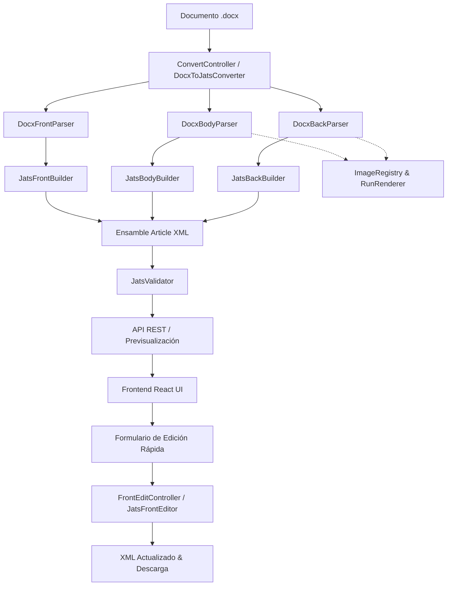

# Documentación Técnica del Proyecto: Conversor DOCX → JATS XML (SciELO Publishing Schema)

**Institución:** Universidad Nacional de Lanús (UNLa) — Licenciatura en Sistemas  
**Marco Académico:** Prácticas Profesionalizantes (PPP)  
**Revista de Aplicación:** *Salud Colectiva* (ISSN 1851-8265 / 1414-9089)  
**Estándares Implementados:** JATS XML 1.1 - 1.3 (NISO Z39.96) / SciELO Publishing Schema (SPS 1.9)  

---

## 1. Visión General del Proyecto

El proyecto tiene como propósito resolver y automatizar la transformación de manuscritos científicos presentados en formato Microsoft Word (`.docx`) al formato estándar internacional **JATS XML** conforme a los lineamientos estrictos de **SciELO Publishing Schema (SPS)** adoptados por la revista académica *Salud Colectiva* de la Universidad Nacional de Lanús.

El sistema se compone de una arquitectura desacoplada:
1. **Backend en Spring Boot (Java 17+)**: Motor de parseo heurístico basado en [Apache POI](backend/pom.xml), procesamiento del DOM XML, extracción estructurada de metadatos, generación modular de secciones (`<front>`, `<body>`, `<back>`), validación sintáctica contra el estándar y endpoints REST.
2. **Frontend en React + Vite**: Interfaz de usuario con identidad visual editorial universitaria (UNLa), carga interactiva por arrastre (drag & drop), previsualización con resaltado de sintaxis, editor reactivo de metadatos del `<front>` con inputs adaptables y exportación de archivos XML o paquetes comprimidos ZIP con imágenes.



---

## 2. Arquitectura de Módulos del Backend

El código del backend en [backend/src/main/java/com/converter/docxjats/](backend/src/main/java/com/converter/docxjats/) fue completamente modularizado para garantizar la separación de responsabilidades:

### 2.1 Orquestador Central: [DocxToJatsConverter.java](backend/src/main/java/com/converter/docxjats/service/DocxToJatsConverter.java)
- Coordina el flujo de conversión de documentos.
- Extrae el archivo a un almacenamiento temporal seguro (`Files.createTempFile`).
- Ejecuta secuencialmente los tres parsers ([DocxFrontParser](backend/src/main/java/com/converter/docxjats/service/DocxFrontParser.java), [DocxBodyParser](backend/src/main/java/com/converter/docxjats/service/DocxBodyParser.java), [DocxBackParser](backend/src/main/java/com/converter/docxjats/service/DocxBackParser.java)) delimitando los rangos de párrafos exactos mediante cursores (`bodyStart`, `bodyEnd`).
- Realiza el ensamblado final del documento con los encabezados DTD oficiales:
  ```xml
  <!DOCTYPE article PUBLIC "-//NLM//DTD JATS (Z39.96) Journal Publishing DTD v1.1 20151215//EN" 
    "https://jats.nlm.nih.gov/publishing/1.1/JATS-journalpublishing1.dtd">
  <article article-type="research-article" dtd-version="1.1" specific-use="sps-1.9" xml:lang="es" ...>
  ```

---

### 2.2 Procesamiento de Metadatos: Sección `<front>`

Módulos involucrados:
- [DocxFrontParser.java](backend/src/main/java/com/converter/docxjats/service/DocxFrontParser.java)
- [JatsFrontBuilder.java](backend/src/main/java/com/converter/docxjats/service/jats/JatsFrontBuilder.java)

#### Funcionalidades implementadas:
1. **Metadatos de Revista y Artículo (`<journal-meta>`, `<article-meta>`):**
   - Detección de identificadores de publicación: DOI (`10.18294/...`), ID editorial (`publisher-id`), volumen, `elocation-id` y número.
   - Parametrización de versión SPS (`specific-use="sps-1.9"`), ISSNs (`ppub` y `epub`), nombre y abreviatura de la revista y editorial (*Universidad Nacional de Lanús*).
2. **Títulos y Traducciones (`<title-group>`):**
   - Captura del título principal (`<article-title>`), subtítulo (`<subtitle>`) y título traducido en inglés (`<trans-title-group xml:lang="en"><trans-title>`), preservando el formato inline (negritas, cursivas).
3. **Autores y Afiliaciones (`<contrib-group>`, `<aff>`):**
   - Extracción de nombres (`<surname>`, `<given-names>`) y detección automática de identificadores persistentes **ORCID** (mediante hipervínculos `orcid.org` o regex de 16 dígitos).
   - Vinculación cruzada mediante superíndices (`<xref ref-type="aff" rid="affX">`).
   - Normalización de afiliaciones institucionales jerárquicas conforme a SciELO:
     - Institución principal (`<institution content-type="orgname">`).
     - Divisiones y unidades académicas (`<institution content-type="orgdiv1">`, `<institution content-type="orgdiv2">`).
     - Cadena completa sin procesar (`<institution content-type="original">`).
     - Localización geográfica: ciudad (`<city>`), provincia/estado (`<state>`) y país con código ISO (`<country country="AR">`).
     - Detección de correos electrónicos (`<email>`).
4. **Historial Editorial (`<history>`):**
   - Reconocimiento de fechas clave del ciclo de vida editorial (`received`, `rev-recd`, `accepted`) en español, inglés y portugués.
   - Conversión de meses textuales a formato normalizado `<day>`, `<month>`, `<year>`.
5. **Resúmenes y Palabras Clave (`<abstract>`, `<kwd-group>`):**
   - Identificación de secciones de resumen en español (`xml:lang="es"`) y en inglés (`xml:lang="en"`).
   - Extracción de palabras clave individuales (`<kwd>`) agrupadas por idioma.
6. **Financiamiento y Notas Editoriales:**
   - Detección de financiamiento (`<funding-group>`, `<award-group>`, `<award-id>`).
   - Notas de autor (`<author-notes>`): declaraciones de conflicto de intereses, contribución autoral (`<fn fn-type="con">`) y correspondencia.

---

### 2.3 Procesamiento del Cuerpo del Texto: Sección `<body>`

Módulos involucrados:
- [DocxBodyParser.java](backend/src/main/java/com/converter/docxjats/service/DocxBodyParser.java)
- [JatsBodyBuilder.java](backend/src/main/java/com/converter/docxjats/service/jats/JatsBodyBuilder.java)
- [RunRenderer.java](backend/src/main/java/com/converter/docxjats/service/jats/RunRenderer.java)
- [ImageRegistry.java](backend/src/main/java/com/converter/docxjats/service/jats/ImageRegistry.java)

#### Funcionalidades implementadas:
1. **Estructura de Secciones Anidadas (`<sec>`):**
   - Detección automática de estilos de Word (`Heading 1..6` / `Título 1..6`).
   - Apertura y cierre jerárquico de etiquetas `<sec id="secX">` con títulos asociados (`<title>`).
   - Asignación inteligente del tipo de sección (`sec-type="intro|methods|results|discussion|conclusions"`).
2. **Formato Tipográfico Inline ([RunRenderer.java](backend/src/main/java/com/converter/docxjats/service/jats/RunRenderer.java)):**
   - Convierte estilos de Apache POI a etiquetas XML: `<bold>`, `<italic>`, `<underline>`, `<sup>`, `<sub>`.
   - Conversión de llamadas bibliográficas numéricas superíndices a referencias cruzadas `<xref ref-type="bibr" rid="BX">`.
   - Limpieza y sanitización de caracteres especiales XML con [XmlUtils.java](backend/src/main/java/com/converter/docxjats/service/jats/XmlUtils.java).
3. **Tablas Estructuradas:**
   - Convierte tablas Word (`XWPFTable`) a la estructura estándar `<table-wrap><table><thead><tbody>`.
   - Preservación de saltos y estilos en celdas individuales eliminando atributos CSS inline innecesarios.
4. **Figuras e Imágenes:**
   - Identificación de párrafos con imágenes (`XWPFPicture`).
   - Almacenamiento en memoria en [ImageRegistry.java](backend/src/main/java/com/converter/docxjats/service/jats/ImageRegistry.java) y referenciación en el XML como `<fig id="figX"><graphic xlink:href="images/imgN.ext"/></fig>`.
   - Soporte para gráficos en línea (`<inline-graphic>`).

---

### 2.4 Procesamiento del Cierre del Documento: Sección `<back>`

Módulos involucrados:
- [DocxBackParser.java](backend/src/main/java/com/converter/docxjats/service/DocxBackParser.java)
- [JatsBackBuilder.java](backend/src/main/java/com/converter/docxjats/service/jats/JatsBackBuilder.java)
- Guía de diseño: [JATS_BACK_BUILDER_GUIDE.md](JATS_BACK_BUILDER_GUIDE.md)

#### Funcionalidades implementadas:
1. **Agradecimientos (`<ack>`):**
   - Captura del encabezado y contenido de agradecimientos a revisores o equipos colaboradores.
2. **Notas al Pie Clasificadas (`<fn-group>`):**
   - Soporte para `financial-disclosure`, `conflict`, `con` (contribución autoral), `equal` y `other`.
3. **Disponibilidad de Datos (`<sec sec-type="data-availability">`):**
   - Detección de la declaración de disponibilidad de bases de datos de la investigación.
4. **Lista de Referencias Bibliográficas Estructuradas (`<ref-list>`):**
   - Detección automática del tipo de publicación:
     - **Artículos de Revistas (`publication-type="journal"`):** extrae autores, título de artículo, nombre de revista, año, volumen, número, páginas y DOI.
     - **Libros (`publication-type="book"`):** extrae autores, título, editorial, ciudad y año.
     - **Tesis (`publication-type="thesis"`):** tipo de tesis, universidad, año.
     - **Sitios Web (`publication-type="webpage"`):** URLs, fechas de consulta (`[citado ...]`).
   - Generación dual requerida por SciELO:
     - `<mixed-citation>`: texto plano completo de la referencia.
     - `<element-citation>`: descomposición granular de cada metadato.

---

### 2.5 Validación Sintáctica y Servicio de Patrones

Módulos involucrados:
- [JatsValidator.java](backend/src/main/java/com/converter/docxjats/service/jats/JatsValidator.java)
- [JatsPatternService.java](backend/src/main/java/com/converter/docxjats/service/JatsPatternService.java)
- [archivosXMLPatron/](archivosXMLPatron/)

#### Funcionalidades implementadas:
1. **Validación XML basada en DOM:**
   - Inspecciona que el elemento raíz sea `<article>`.
   - Verifica la presencia obligatoria de `<front>` (con `<journal-meta>` y `<article-meta>`), `<body>` y `<back>`.
   - Retorna una estructura [ValidationResult](backend/src/main/java/com/converter/docxjats/service/jats/JatsValidator.java) con la lista de errores encontrados.
2. **Homologación con Artículos Patrón Certificados:**
   - Integración con los artículos certificados de la revista *Salud Colectiva*:
     - **Artículo 5939:** *Prácticas de fin de vida y directivas anticipadas de voluntad* ([1851-8265-scol-22-e5939.xml](archivosXMLPatron/1851-8265-scol-22-e5939.xml) / [ID-5939](ID-5939_Eich%20et%20al_XML-es%20(2).docx)).
     - **Artículo 6032:** *Cesáreas como expresión biopolítica del nacimiento* ([1851-8265-scol-22-e6032.xml](archivosXMLPatron/1851-8265-scol-22-e6032.xml) / [ID-6032](ID-6032_Perner+et+al_Word-XML.docx)).
   - Pruebas automatizadas en [JatsControllerTest.java](backend/src/test/java/com/converter/docxjats/controller/JatsControllerTest.java) con Spring Boot MockMvc.

---

### 2.6 Edición Rápida del `<front>` (In-Place)

Módulos involucrados:
- [JatsFrontEditor.java](backend/src/main/java/com/converter/docxjats/service/jats/JatsFrontEditor.java)
- [FrontEditController.java](backend/src/main/java/com/converter/docxjats/controller/FrontEditController.java)
- [FrontFields.java](backend/src/main/java/com/converter/docxjats/dto/FrontFields.java)

#### Funcionalidades implementadas:
- Permite leer y reescribir metadatos del `<front>` directamente sobre el XML ya generado **sin requerir volver a cargar el .docx**:
  - `POST /api/convert/front-fields`: parsea el XML actual y devuelve en JSON los campos del formulario.
  - `POST /api/convert/apply-front`: aplica las ediciones sobre el DOM XML y devuelve el nuevo XML revalidado.
  - `POST /api/convert/export-xml`: descarga el XML editado directamente como archivo `.xml`.

---

## 3. Desarrollo en el Frontend (React + Vite)

El frontend en [frontend/src/](frontend/src/) fue diseñado con una estética editorial universitaria cuidada:

1. **Diseño e Identidad Institucional:**
   - Tipografía refinada: *Source Serif 4* para encabezados editoriales, *Inter* para elementos de UI y *JetBrains Mono* para código XML.
   - Paleta institucional UNLa (color borravino/granate `#800000`, fondo papel `#f4f3ef`, acentos `#1c2430`).
   - Incorporación del logo oficial de la Universidad Nacional de Lanús ([unla-logo.png](frontend/src/assets/unla-logo.png)).
2. **Componente de Entrada Adaptable (`AutoInput`):**
   - Inputs inteligentes en [App.jsx](frontend/src/App.jsx) que calculan dinámicamente su anchura en unidades de caracteres (`ch`), evitando formularios estáticos desalineados.
3. **Formulario de Edición Integral de Metadatos:**
   - **Datos de Revista:** Título, editorial, ISSN impreso y electrónico.
   - **Identificadores y Fechas:** DOI, ID editorial, día, mes y año de publicación.
   - **Títulos y Resúmenes:** Título original, subtítulo, traducción al inglés, resumen en español y abstract en inglés.
   - **Palabras Clave:** Edición de listas de términos en español e inglés.
   - **Permisos y Licencia:** Declaración de copyright y URL de la licencia Creative Commons.
   - **Gestión Dinámica de Autores:** Incorporación, modificación o remoción de autores, especificando nombre, apellido, ORCID, correo electrónico y filiación institucional.
4. **Auto-completado y Extracción de Correos y Afiliaciones:**
   - Función cliente `parseAuthorsFromXml` en [App.jsx](frontend/src/App.jsx) que lee elementos `<contrib>`, resuelve las referencias `<xref rid="...">` contra los nodos `<aff>` e identifica correos asociados automáticamente.
5. **Visor XML Integrado:**
   - Previsualización interactiva con coloreado sintáctico de etiquetas XML en el bloque de salida.

---

## 4. Matriz de Endpoints de la API REST

| Método | Endpoint | Parámetros / Body | Descripción |
| :--- | :--- | :--- | :--- |
| `POST` | `/api/convert/preview` | Multipart (`file`: `.docx`) | Convierte el archivo y devuelve el XML plano junto con la cantidad de imágenes detectadas. |
| `POST` | `/api/convert/xml` | Multipart (`file`: `.docx`) | Descarga directa del archivo XML generado (`<nombre>-jats.xml`). |
| `POST` | `/api/convert/package` | Multipart (`file`: `.docx`) | Descarga un `.zip` conteniendo `article.xml` y la subcarpeta `images/` con los binarios de las imágenes. |
| `POST` | `/api/convert/front-fields` | JSON: `{"xml": "..."}` | Extrae los campos editables del `<front>` desde el XML para precargar el formulario. |
| `POST` | `/api/convert/apply-front` | JSON: `{"xml": "...", "front": {...}}` | Aplica los campos editados en el XML y ejecuta la validación DOM. |
| `POST` | `/api/convert/export-xml` | JSON: `{"xml": "...", "filename": "..."}` | Descarga el XML editado como archivo adjunto `.xml`. |
| `GET / POST` | `/jats/{articleId}` | Path o JSON: `articleId` (`5939`, `6032`) | Recupera y valida el documento XML patrón correspondiente de la revista *Salud Colectiva*. |

---

## 5. Historial de Hitos y Correcciones Aplicadas

De acuerdo al registro de control de versiones y diagnóstico de la práctica:

| Área | Problema Inicial | Solución Implementada |
| :--- | :--- | :--- |
| **Arquitectura** | Monolito de parseo difícil de mantener | Separación modular en `DocxFrontParser`, `DocxBodyParser`, `DocxBackParser` y sus respectivos Builders. |
| **Metadatos SciELO** | Fuga de metadatos del encabezado al cuerpo del documento (`<body>`) | Delimitación estricta de índices de párrafos (`bodyStart` / `bodyEnd`) calculados tras consumir el front. |
| **Geografía de Afiliaciones** | Excepciones o falta de atributos ante ciudades/estados con formatos variados | Regex `LOCATION_COUNTRY_TAIL` con soporte bidireccional para 2 partes (*Rosario, Argentina*) y 3 partes (*Campinas, SP, Brasil*). |
| **Instituciones** | Texto plano sin separación jerárquica | Normalización en `<institution content-type="orgname">`, `orgdiv1` y `orgdiv2` sin caracteres de puntuación residuales. |
| **Fechas de Historial** | Errores por formatos de mes con/sin preposición "de" o numéricos | Mapeo léxico multi-idioma (español, portugués, inglés) extrayendo componentes hacia formato estándar `<date>`. |
| **Referencias (`<back>`)** | Referencias truncadas y texto sin estructurar | Parser heurístico con expresiones regulares por tipología (journal, book, thesis, webpage) y generación dual `<mixed-citation>` + `<element-citation>`. |
| **Tablas y Estilos** | Inyección de estilos CSS inline que rompían el renderizador de SciELO | Remoción de CSS inline y delegación del diseño a hojas XSLT/CSS del visor editorial. |
| **UI & Experiencia** | Formulario estático y pérdida de correos al editar autores | Extracción cliente-servidor de correos y afiliaciones, inputs elásticos (`AutoInput`) y previsualización en tiempo real. |

---

## 6. Caminos Desechados y Decisiones Técnicas Críticas (Lecciones Aprendidas)

Uno de los requerimientos metodológicos esenciales de la Práctica Profesionalizante y del posterior Trabajo Final de Integración (TFI) consiste en registrar **no solo el código funcional final, sino también las hipótesis refutadas, los enfoques descartados y los obstáculos superados**. Documentar las vías que no condujeron a buen puerto previene regresiones y fundamenta la madurez de la solución técnica:

### 6.1 Descarte del "Peso del Archivo" como Criterio de Verificación
- **Hipótesis inicial:** En etapas tempranas de experimentación, se asumió que si el tamaño en bytes del XML generado era equivalente al del archivo XML patrón de referencia de la cursada, la conversión era correcta.
- **Razón del descarte:** En la especificación XML JATS, el tamaño en disco es una métrica engañosa y espuria. Un documento con relleno de espacios o texto duplicado puede tener un peso idéntico a un archivo patrón, pero fallar críticamente por una etiqueta mal anidada (ej.: un `<italic>` dentro de un nodo no admitido o un `<contrib>` huérfano). La conformidad editorial exige **precisión semántica estricta en el árbol DOM y cumplimiento del DTD/XSD**, independientemente del peso en bytes.
- **Solución adoptada:** Sustituir la comparación de tamaño por **validación estructural de esquemas y evaluación mediante Stylecheckers formales** (SciELO y PubMed Central).

### 6.2 Descarte del Parseo Monolítico con Expresiones Regulares sobre Texto Plano
- **Hipótesis inicial:** Extraer todo el texto del `.docx` a un String continuo mediante Apache POI y aplicar expresiones regulares complejas para detectar autores, títulos y secciones.
- **Razón del descarte:** Provocaba pérdida irremediable del contexto estructural:
  1. No era posible asociar superíndices de llamadas de notas al pie o afiliaciones con su autor correspondiente.
  2. Los estilos de Word (negrita, cursiva, enlaces) quedaban desfasados o se perdían al convertir a texto plano.
  3. Las tablas e imágenes incrustadas no encajaban en un flujo textual lineal sin romper la secuencia de párrafos.
- **Solución adoptada:** Procesar directamente el modelo de objetos de POI (`XWPFDocument`, `XWPFParagraph`, `XWPFRun`, `XWPFTable`) conservando los atributos XML subyacentes (`w:rPr`, `w:vertAlign`) en un pipeline de tres etapas independientes (`Front`, `Body`, `Back`).

### 6.3 Descarte de Estilos CSS Inline en Tablas
- **Hipótesis inicial:** Conservar los anchos de columna en píxeles, colores de fondo (`background-color`) y bordes que los autores configuran en Microsoft Word e inyectarlos como atributos `style="..."` dentro de `<table>`, `<tr>` y `<td>`.
- **Razón del descarte:** Los visores y stylesheets XSLT oficiales de SciELO (como *SciELO Publishing Framework* o visores PMC) rechazan o desfiguran el marcado cuando detectan estilos visuales inline ad-hoc. SciELO impone el principio de **separación estricta entre semántica de datos y presentación visual**.
- **Solución adoptada:** Limpiar todo el CSS inline y generar exclusivamente marcado estructural semántico (`<table-wrap>`, `<table>`, `<thead>`, `<tbody>`, `<tr>`, `<th>`, `<td>`), permitiendo que el diseño tipográfico y responsive sea gestionado por el motor de publicación editorial o el visor OJS.

### 6.4 Descarte del Almacenamiento de Imágenes en Base64 Embebido
- **Hipótesis inicial:** Incrustar los binarios de las imágenes directamente dentro del XML como cadenas Base64 (`<graphic>data:image/png;base64,...</graphic>`).
- **Razón del descarte:** JATS y SciELO prohíben la serialización en Base64 para figuras del artículo. El estándar exige referencias relativas a archivos externos (`<graphic xlink:href="images/img1.png"/>`) para posibilitar la optimización independiente, indexación en repositorios y generación de miniaturas.
- **Solución adoptada:** Creación del servicio [ImageRegistry.java](backend/src/main/java/com/converter/docxjats/service/jats/ImageRegistry.java) y empaquetado final en archivo ZIP (`POST /api/convert/package`) con estructura estándar: `article.xml` en la raíz y carpeta `images/` con los archivos originales extraídos del DOCX.

### 6.5 Descarte del Reprocesamiento Completo de DOCX para Ajustes Menores de Metadatos
- **Hipótesis inicial:** Si un usuario detectaba un error ortográfico en el título o un ORCID faltante, debía modificar el archivo Word original y reiniciar toda la conversión.
- **Razón del descarte:** Este flujo resultaba lento, propenso a frustración editorial y generaba discrepancias entre versiones intermedias del manuscrito.
- **Solución adoptada:** Implementación de la arquitectura de edición in-place con [JatsFrontEditor.java](backend/src/main/java/com/converter/docxjats/service/jats/JatsFrontEditor.java): el usuario edita los campos del `<front>` directamente en la interfaz web interactiva y el backend actualiza el DOM XML en memoria en milisegundos sin requerir re-conversión del archivo original.

---

## 7. Marco Teórico y de Estándares: JATS DTD y SciELO Publishing Schema (SPS)

El desarrollo del conversor se fundamenta en estándares internacionales de preservación digital y marcación de literatura científica:

### 7.1 Estándar NISO JATS (Z39.96) y Evolución de DTDs
**JATS (Journal Article Tag Suite)** es la norma ANSI/NISO Z39.96 desarrollada por la Biblioteca Nacional de Medicina de los Estados Unidos (NLM) para la estructuración semántica de manuscritos científicos.
- **JATS 1.0 (2012):** Primera estandarización formal por NISO.
- **JATS 1.1 (2015):** Versión de referencia consolidada en la producción editorial global. Introduce soporte robusto para identificadores persistentes (DOI, ORCID, FundRef), licencias de acceso abierto con metadatos ALI (`<ali:license_ref>`), y esquemas de disponibilidad de datos.
- **JATS 1.2 / 1.3 (2019-2021):** Incorporación de taxonomías estandarizadas para roles de autoría (CRediT - *Contributor Roles Taxonomy*), identificadores ROR (*Research Organization Registry*) y marcado enriquecido para repositorios pre-print y ciencia abierta.

### 7.2 SciELO Publishing Schema (SPS 1.9 vs. 1.10)
SciELO (*Scientific Electronic Library Online*) adopta JATS pero impone un conjunto de reglas, restricciones y validaciones adicionales denominado **SPS**:
- **`specific-use="sps-1.9"`:** Versión vigente ampliamente homologada en las colecciones SciELO. Exige:
  1. Estructuración dual obligatoria de referencias bibliográficas: `<mixed-citation>` (texto completo para lectura humana) y `<element-citation>` (desglose de campos para indexadores).
  2. Identificación estricta de afiliaciones institucionales normalizadas con país en norma ISO 3166-1 alfa-2.
  3. Marcado obligatorio de declaraciones de conflicto de intereses, contribución de autoría y disponibilidad de datos.
  4. Atributo `xml:lang` en elementos multilingües (títulos traducidos, resúmenes, palabras clave).
- **SPS 1.10 (Nueva especificación):** Avanza en la exigencia de trazabilidad del proceso editorial: obligatoriedad del rol de los editores asociados, soporte formal para preprints citados y ampliación de esquemas de datos abiertos conforme al movimiento de Ciencia Abierta.

### 7.3 Taxonomía del Atributo `article-type`
El elemento raíz `<article>` debe tipificar la naturaleza académica del texto conforme a la [Tag Library de la NLM](https://jats.nlm.nih.gov/nlm-dtd/articleauthoring/tag-library/2.1/n-24v0.html):
- `research-article`: Artículo de investigación original con resultados empíricos o teóricos.
- `review-article`: Artículo de revisión bibliográfica, sistemática o meta-análisis.
- `editorial`: Texto de opinión o balance escrito por el equipo editorial.
- `letter`: Carta al editor o comunicación breve sobre artículos previamente publicados.
- `case-report`: Reporte de caso clínico o institucional.
- `brief-report`: Comunicación corta o reporte breve de resultados preliminares.
- `book-review`: Reseña de un libro de reciente publicación.

---

## 8. Visión Multirevista ("I Love XML-JATS") y Arquitectura de los 4 Bloques

Pensando en la evolución de la herramienta hacia un servicio multirevista universal —un **"I Love XML-JATS"** accesible para cualquier publicación científica académica—, se identificó un principio clave: **el archivo Word del autor nunca contiene la totalidad de los metadatos de publicación final**. 

La publicación electrónica exige datos institucionales y de catalogación propios del equipo editorial. Para resolver esto de manera desacoplada, el sistema estructura la información editorial en **4 bloques fundamentales**:

```
+---------------------------------------------------------------------------------+
|                      INSTANCIA DE CONFIGURACIÓN EDITORIAL                        |
+---------------------------------------------------------------------------------+
| BLOQUE 1: Tipo de Artículo                                                      |
|   <article article-type="research-article" ...>                                 |
+---------------------------------------------------------------------------------+
| BLOQUE 2: Versiones de Estándares Raíz                                          |
|   dtd-version="1.1" specific-use="sps-1.9" xml:lang="es"                        |
+---------------------------------------------------------------------------------+
| BLOQUE 3: Datos de Revista, Editorial y Sección                                 |
|   <journal-meta>: NLM-TA, publisher-id, journal-title, issn ppub/epub,         |
|                   publisher-name                                                |
|   <article-meta>: DOI, <subj-group subj-group-type="heading"><subject>          |
+---------------------------------------------------------------------------------+
| BLOQUE 4: Fechas, Numeración, Historial y Licencias                             |
|   <pub-date> (electrónica y colección), <volume>, <elocation-id>                |
|   <history>: <date date-type="received|accepted|pub">                           |
|   <permissions>: Creative Commons (CC BY 4.0, CC BY-NC 4.0, etc.)              |
+---------------------------------------------------------------------------------+
```

Esta configuración permite parametrizar perfiles por revista, de modo que *Salud Colectiva* u otra publicación universitaria pueda precargar sus datos institucionales y procesar manuscritos en lote garantizando consistencia.

---

## 9. Protocolo de Calidad y Validación con Stylecheckers Formales

Para asegurar que los archivos XML generados por la herramienta sean aceptados directamente por los índices internacionales sin requerir remediación manual, el flujo de desarrollo se valida contra los motores oficiales de auditoría de calidad:

1. **SciELO Stylechecker Oficial:**
   - **URL del servicio:** [https://manager.scielo.org/tools/validators/stylechecker/](https://manager.scielo.org/tools/validators/stylechecker/)
   - **Función:** Analiza la conformidad con el esquema SPS vigente, validando la estructura del `<front>`, los códigos de país de las afiliaciones, las fechas del `<history>` y la consistencia de las referencias bibliográficas en `<ref-list>`.
2. **PubMed Central (PMC) Stylechecker:**
   - **URL del servicio:** [https://pmc.ncbi.nlm.nih.gov/tools/stylechecker/](https://pmc.ncbi.nlm.nih.gov/tools/stylechecker/)
   - **Función:** Valida la conformidad estricta contra el DTD oficial de NISO JATS y las directrices de indexación de la National Library of Medicine.

La aplicación integra dentro de su interfaz herramientas directas para facilitar la auditoría en estas plataformas (copiado rápido de XML, descarga de paquetes ZIP normados y enlaces directos a los validadores).

---

## 10. Proyección hacia el Trabajo Final de Integración (TFI)

El desarrollo realizado en estas Prácticas Profesionalizantes sienta las bases sólidas para el **Trabajo Final de Integración (TFI)** de la Licenciatura en Sistemas de la UNLa:

### 10.1 Definición y Relevancia del Problema
En el ecosistema científico actual, los investigadores redactan sus manuscritos en procesadores de texto comerciales (predominantemente Microsoft Word) que producen texto no estructurado. Por otro lado, la indexación en bases de datos de alto impacto (SciELO, PubMed Central, Redalyc, Latindex) y la publicación en plataformas como Open Journal Systems (OJS) exigen el estándar semántico JATS XML.

La marcación manual o mediante herramientas comerciales propietarias presenta tres problemas críticos para las universidades públicas:
1. **Altos costos operativos:** Las herramientas propietarias imponen licencias onerosas o tarifas por artículo procesado.
2. **Curva de aprendizaje pronunciada:** Los editores deben capacitarse en complejas herramientas de marcado sintáctico etiqueta por etiqueta.
3. **Pérdida de soberanía tecnológica:** Dependencia de proveedores externos para cumplir con los estándares de indexación.

### 10.2 Hipótesis y Aporte del TFI
El TFI profundizará en:
- El diseño de algoritmos heurísticos avanzados para la extracción semántica automatizada de metadatos en lenguas española y portuguesa.
- La consolidación de una plataforma web libre y autogestionada (modelo *"I Love XML-JATS"*) orientada a editoriales universitarias públicas.
- La integración directa mediante APIs con plataformas de gestión editorial como **OJS (Open Journal Systems)** y validadores automáticos Schematron.

---

## 11. Guía de Ejecución y Pruebas

### 11.1 Requisitos del Sistema
- Java 17 o superior.
- Maven 3.8+ instalado en el entorno.
- Node.js 18+ y npm.

### 11.2 Ejecución del Backend
```bash
cd backend
mvn clean test        # Ejecuta las pruebas unitarias y de integración
mvn spring-boot:run   # Inicia el servidor en http://localhost:8080 (o 8081 según configuración)
```

### 11.3 Ejecución del Frontend
```bash
cd frontend
npm install
npm run dev           # Inicia el entorno de desarrollo en http://localhost:5173
```

---

## 12. Conclusión y Estado de Cumplimiento

El trabajo realizado en la Práctica Profesionalizante cumple de manera exhaustiva con los objetivos de:
1. **Conformidad Estándar:** Generación de marcado XML alineado con el esquema oficial **SciELO Publishing Schema (SPS 1.9)** y **JATS 1.1 - 1.3**.
2. **Modularidad y Mantenibilidad:** Código estructurado en capas con separación neta entre lectura de modelos Word, representación de datos y generación XML.
3. **Calidad Editorial:** Soporte para artículos reales y complejos de la revista *Salud Colectiva*, cubriendo elementos gráficos, tablas, jerarquías de secciones, notas críticas y referencias bibliográficas analizadas granularmente.
4. **Herramienta Integrada:** Entrega de una aplicación web completa con previsualización, edición in-place, soporte para la visión multirevista de 4 bloques y exportación lista para su validación en Stylecheckers formales e incorporación a plataformas como OJS.
